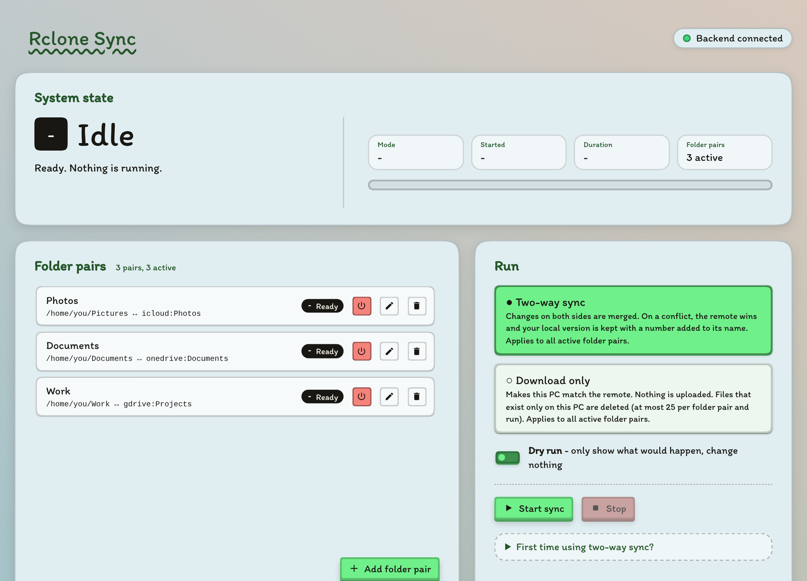
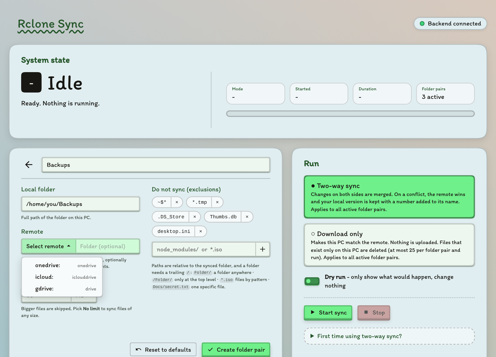
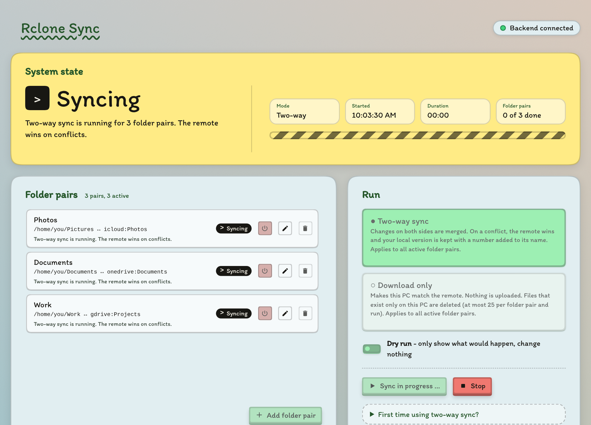
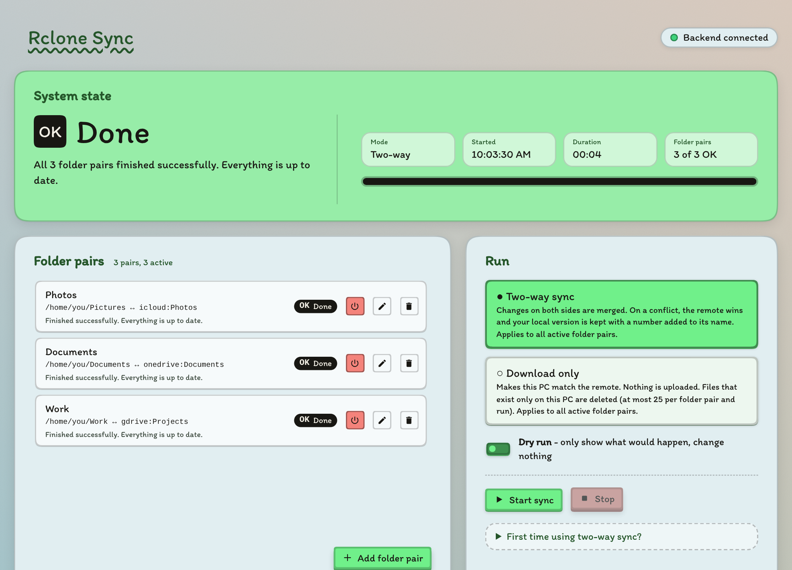
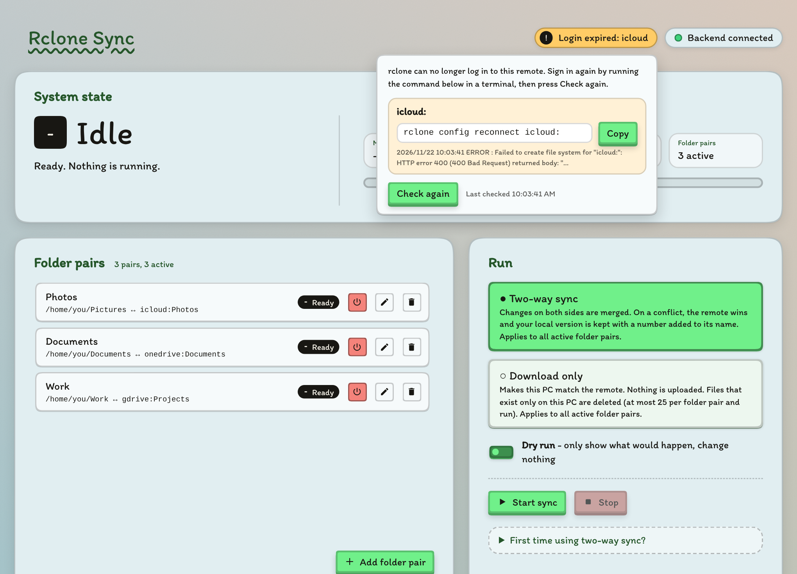

# Rclone Sync

Rclone Sync keeps folders on your computer in step with your cloud storage (OneDrive, Google Drive, iCloud and every other service rclone supports). It is a small app with a friendly window on top of the `rclone` you already have installed. You pick the folders, press one button, and the app always tells you in plain words what it is doing.



## What it does

- **Syncs several folders at once.** Each pair of a local folder and a cloud folder is synced on its own, side by side.
- **Two ways to sync.** *Two-way* merges changes made on both sides. *Download only* makes your computer match the cloud.
- **Shows the system state at a glance.** The big card at the top says whether the app is idle, syncing, done, failed or stopped, with a progress bar and a live log below.
- **Warns you when a login expires.** If a cloud (iCloud, for example) needs you to sign in again, a badge appears at the top with the command to fix it.
- **Stays on your computer.** The app only answers requests from this computer, never from the network.

## Before you start

- Python 3.9 or newer.
- rclone 1.66 or newer, installed and with at least one remote set up (`rclone config`).

## Starting the app

```
python run.py --open
```

This opens the app in your browser at `http://127.0.0.1:8765`.

If you prefer a window of its own with an icon in your dock:

```
python run_desktop.py                      # open the app
python run_desktop.py --install-launcher   # once: adds it to your app menu
```

The window version needs pywebview and the WebKitGTK library. If something is missing, the app prints what to install.

## How to use it

### 1. Add a folder pair

Press **Add folder pair**, give it a name, choose the folder on your computer and pick your cloud from the **Remote** dropdown. You can add a folder on the cloud after it, such as `Documents/Work`. Then press **Create folder pair**.



The dropdown lists every remote rclone knows. If yours is missing, add it with `rclone config` and open the form again; no restart is needed.

Two optional settings sit next to it:

- **Maximum file size.** Bigger files are skipped. Choose *No limit* to sync everything.
- **Do not sync (exclusions).** Files and folders to leave out:

| Pattern | Meaning |
|---------|---------|
| `Folder/` | a folder with that name, anywhere |
| `/Folder/` | only the top-level folder |
| `*.iso` | all files matching a pattern |
| `Docs/secret.txt` | one specific file |

### 2. Choose how to sync

On the right, pick a mode. It applies to all active folder pairs.

| Mode | What happens |
|------|--------------|
| **Two-way sync** | Changes on both sides are merged. If the same file changed on both, the cloud version wins and your local version is kept with a number added to its name. |
| **Download only** | Your computer is made to match the cloud. Nothing is uploaded. Files that exist only on your computer are deleted (at most 25 per folder pair and run). |

Switch on **Dry run** to see what would happen without changing anything.

### 3. First time with two-way sync

Open **First time using two-way sync?** and press **Run first-time setup**. This builds the starting point that two-way sync needs. You only do this once per folder pair, and again if rclone asks for it after you change a pair's exclusions.

### 4. Press Start sync



The system state card turns yellow while syncing, and every folder pair shows its own state. The log at the bottom lists what rclone does. **Stop** ends the run safely at any time. Folder pairs cannot be edited while a sync runs.

When everything has finished, the card turns green.



If one folder pair fails, the others carry on, and the overall state says *Failed* so you notice.

## Good to know

- **Switch a pair off** with its power button to leave it out for now without deleting it.
- **Nested pairs are handled for you.** If one pair lies inside another (for example `Docs/Photos` inside `Docs`), the outer pair skips the inner folder automatically so nothing is synced twice. Pairs that overlap in any other way cannot be saved, and the message names the pair they clash with.
- **Everything is stored in the `data` folder** next to the app, so you can back up your folder pairs by copying `data/pairs.json`.
- **Change the port** with the environment variable `RCLONE_SYNC_PORT`, or use another rclone program with `RCLONE_SYNC_BINARY`.

## When a login expires

Some clouds, iCloud in particular, ask you to sign in again from time to time. When rclone can no longer log in to a cloud you use, an orange badge appears next to *Backend connected*.



Click it, copy the command (for example `rclone config reconnect icloud:`), run it in a terminal, and press **Check again**. The badge disappears once the login works. The app checks your clouds by itself every 30 minutes while no sync is running.

## Notes about other clouds

The sync settings are the same for every cloud. Some services do not support every rclone option, so if a run fails with an error about an unsupported option, the log will say which one.

## License

See [LICENSE](LICENSE).
